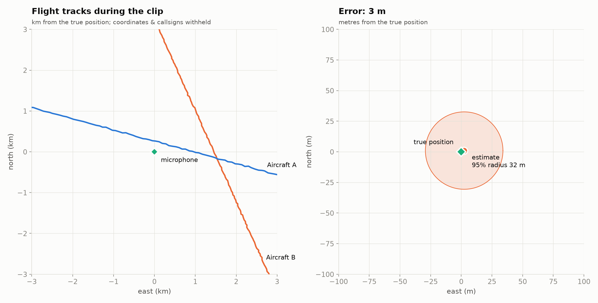
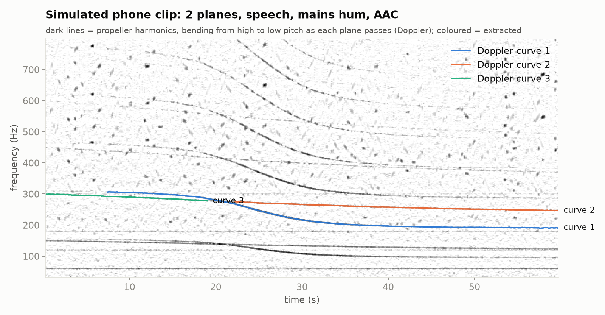
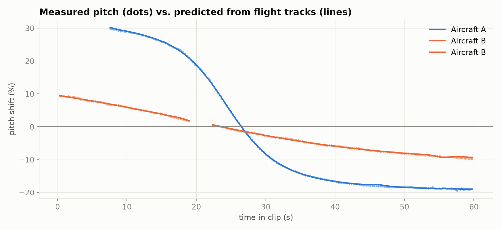
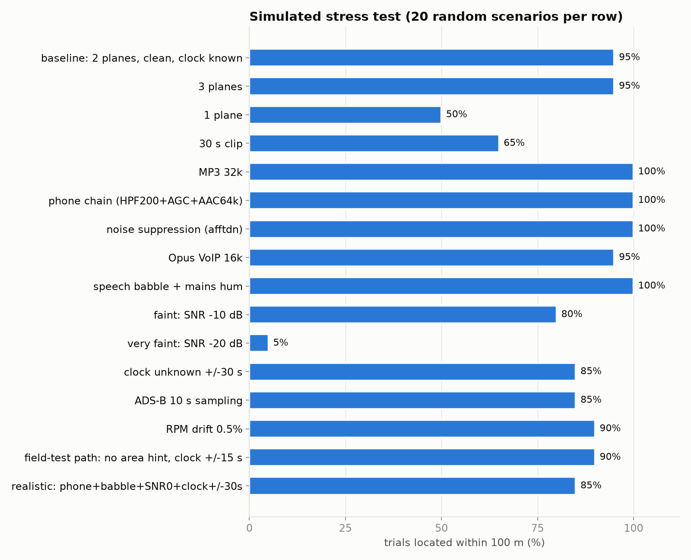

# propgeo: where was this video recorded? Ask the planes.

[](https://github.com/Jackychen8/prop-geolocate/actions/workflows/test.yml)

An open-source implementation of the propeller-Doppler geolocation technique: recover where a recording was
made from the **pitch curves of passing propeller aircraft** in its background audio, matched against
public **ADS-B** flight tracks. Includes a physics simulator, a Monte-Carlo stress test of the published
claims, a field-test kit for trying it on yourself, a CLI and a Streamlit UI.



*Simulated phone clip (2 planes, speech, mains hum, AAC): 3 m error. Privacy-mode output, axes relative to the true position.*

## How it works



1. **Hear the planes.** A propeller emits a strong tone at its blade-passing frequency, plus harmonics.
   As the plane passes, the tone bends from high to low pitch (Doppler). The tool tracks the tonal peaks
   in a high-resolution spectrogram and groups harmonics of the same plane: their log-frequencies move in
   lockstep. It cuts tracks wherever two planes' tones nearly collide, where a tracker could jump between
   sources, and drops stationary tones such as hum and fans.
2. **Predict the planes.** ADS-B gives each aircraft's position about once a second. A smoothing spline
   turns that into position and velocity. For any candidate microphone position, the model solves the
   emission ("retarded") time of every sound sample and predicts the Doppler curve.
3. **Find the one spot where everything lines up.** A grid search over position and clock offset, then
   robust least squares. Each curve's at-rest pitch is a free nuisance parameter, and each curve picks
   whichever aircraft explains it. Points or curves nothing explains get a capped cost, so cars, birds and
   planes without ADS-B can't drag the fit. Distinct solutions that fit nearly as well are reported as
   **ambiguous**, not hidden.



## Does the claim hold? (simulation, 440 trials)



| What was claimed | What the stress test says |
|---|---|
| **~100 m accuracy** | **Yes, with 2+ planes.** Nominal conditions: median **12 m**, 98% within 100 m. Realistic mix (phone audio, speech, faint planes, clock off by up to ±30 s): median 37 m, 85% within 100 m. |
| **Survives phone compression, noise suppression, MP3** | **Yes.** MP3 32k, phone chain (200 Hz high-pass + AGC + AAC 64k), spectral noise suppression and Opus 16k VoIP all stay at an 11-13 m median. Harmonics up to 1.5 kHz survive; losing the fundamental doesn't matter. |
| **Under 60 s of audio** | **Fragile.** 30 s clips: 65% within 100 m. A plane's closest approach often falls outside the clip. |
| *(implied)* any plane will do | **No: one plane is ambiguous.** A single straight pass fits its mirror image across the flight path, and sometimes a *different* ADS-B aircraft somewhere else, equally well. Only 50% are top-1 correct; the tool flags most of these instead of over-claiming. |
| Faint background | Down to about −10 dB broadband SNR (80% within 100 m). At −20 dB the tones are mostly undetectable. |

Full table: [`docs/results/benchmark_summary.md`](docs/results/benchmark_summary.md). Raw per-trial data:
[`docs/results/benchmark_trials.csv`](docs/results/benchmark_trials.csv). In each trial the searcher gets only
a rough area (~2 km off), or none at all in the "field-test path" row, plus an ADS-B feed that includes 4 distractor
aircraft that aren't in the audio.

Other error sources measured: unknown clock (along-track position trades off against time), ADS-B at
10 s resolution (OpenSky anonymous), engine RPM wander (it looks like Doppler), wrong ground elevation.
The reported 95% radius holds 90-95% of the time in nominal conditions and 60-80% with an unknown clock
or RPM wander, so treat it as optimistic there.

## Field results

*Coming soon: a real recording, scored against GPS truth. Try it yourself: [`docs/FIELD_TEST.md`](docs/FIELD_TEST.md).*

## Quick start

```bash
git clone https://github.com/Jackychen8/prop-geolocate && cd prop-geolocate
python -m venv .venv && .venv/bin/pip install -e '.[test]'      # also needs ffmpeg on PATH
.venv/bin/streamlit run app.py                                  # UI: simulate or upload, see the map
.venv/bin/python -m pytest -q                                   # 14 tests, ~1 min
```

| Command | What it does |
|---|---|
| `python -m propgeo simulate --seed 11 --out out/sim` | synthetic clip (`clip.m4a` with timestamp), ADS-B CSV, ground truth |
| `python -m propgeo locate CLIP --adsb CSV [--window 15] [--center lat,lon] [--elev m]` | locate a recording, JSON out |
| `python -m propgeo capture --lat .. --lon .. --duration 1200` | log live ADS-B (adsb.lol, no key; your point is rounded to ~11 km) |
| `python -m propgeo field-test CLIP --adsb CSV --truth lat,lon --elev m` | real recording → privacy-safe figures + error numbers |
| `python -m propgeo benchmark --trials 20` | the Monte-Carlo stress test (~10 min) |
| `python -m propgeo figures` | regenerate the images in `docs/img/` |

ADS-B input is any CSV in OpenSky `state_vectors_data4` layout; readsb/adsb.lol column names work too. Older
clips need historical ADS-B: adsb.lol publishes every day back to 2023 as open data
([`globe_history`](https://github.com/adsblol/globe_history_2026), no account needed), and OpenSky's Trino
archive needs a research account.

**How exposed is a typical person?** See [`docs/results/exposure.md`](docs/results/exposure.md): measured
Bay Area traffic from that archive, and the share of the US population living near an airport.

## Responsible use

This is a privacy-research tool: it exists to show that **background audio plus a timestamp can be a
location fingerprint**, even with no landmarks in frame. Don't use it to locate people who haven't
consented. The field-test output is privacy-preserving by default (no coordinates, callsigns or times),
because publishing those would let anyone redo the fit.

Mitigations worth testing (not yet benchmarked here): replacing or stripping ambient audio, posting
with a delay, and pitch-perturbing low-frequency tonal components.

## Limitations

* The simulator and solver share a physics model (straight rays, uniform sound speed). Refraction,
  ground reflections, terrain and real propeller directivity will cost accuracy in the field.
* Observer height must be in the ADS-B geometric datum (WGS84 ellipsoid): elevation above sea level
  plus geoid height. 50 m wrong ≈ 30 m position error.
* Needs ADS-B-equipped propeller traffic within a few km, which is common near general-aviation airports.
* Clock-free searches take about 40 s; otherwise about 5 s.

## Code map

`propgeo/`: `physics` (retarded-time Doppler), `extract` (audio → curves), `locate` (solver),
`adsb` (load/smooth/live capture), `simulate` (ground-truth generator), `audio_io` (ffmpeg decode and
degradation chains), `geo` (WGS84/ENU), `report` (figures), `benchmark`, `cli`. `app.py` is the UI.

MIT licensed.
